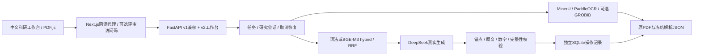

# 研枢 ScholarGraph

**每一句回答，都能点回原文的那一页。**

面向个人科研的论文工作台：导入PDF、查看原版式、按证据问答、翻译对照、获取与追踪文献、分析引用图谱、辅助写作和CSV绘图。项目采用B「青瓷书页」界面，顶部常驻导航使用可关闭的局部液态玻璃与缓慢高光，正文保持清晰实体阅读面。

团队：**黄伟浩 / 广州商学院 / B 组个人赛**。公开仓库：[hoanhkhai1hk-wq/scholar-graph](https://github.com/hoanhkhai1hk-wq/scholar-graph)。本项目代码采用[MIT](LICENSE)；第三方引擎和模型分别遵循各自许可证，见[组件登记](docs/open-source-register.md)。

当前结论：各项真实实测、失败与修复记录均保留；**尚不能宣布完全符合命题**。公式自动LaTeX准确性、部分参考文献全文获取及公网交付仍有边界。以[提交总检查](docs/提交总检查报告.md)、[逐项报告](test-records/)和[技术文档](docs/technical-document.pdf)为准。

## 安装与运行

推荐Docker Compose。需要Git、Docker Desktop/Engine与Compose；首次构建需下载公开依赖。向量权重、OCR权重和论文数据不随仓库提供，不把已有依赖镜像的本地验收说成任意新机器均已验证。

```powershell
git clone https://github.com/hoanhkhai1hk-wq/scholar-graph.git
cd scholar-graph
if (!(Test-Path .env)) { Copy-Item .env.example .env }
if (!(Test-Path docker-compose.override.yml)) {
  Copy-Item deploy/compose.provider.example.yml docker-compose.override.yml
}
```

在本地.env填写DEEPSEEK_API_KEY和DEEPSEEK_MODEL，override只保留变量引用。已有配置应合并，不覆盖。没有Key时可启动基本服务；翻译和真实生成诚实报错，不编造译文。外部模型会收到所选论文材料，个人资料只在自己授权范围使用。

```powershell
docker compose config -q
docker compose build
docker compose up -d --wait
docker compose ps
docker compose exec -T frontend getent hosts backend
docker compose exec -T backend python -c "import os; print('KEY_SET' if os.environ.get('DEEPSEEK_API_KEY') else 'KEY_MISSING'); print('MODEL_SET' if os.environ.get('DEEPSEEK_MODEL') else 'MODEL_MISSING')"
```

全新安装默认网页[3000](http://127.0.0.1:3000)、后端8000，仅绑定本机。当前工作站本地.env将主后端设为8030；已有体验库[3400](http://127.0.0.1:3400)是单独验收项目，与3000个人库隔离。容器间始终使用backend:8000，宿主端口不能替代容器端口。更改Key后必须`docker compose up -d --wait backend`，仅restart不会载入新环境。

首次进入：上传论文→等逐文件解析完成→打开阅读→在研究助手提问→展开并点击原文依据。跨篇研究先在“研究问答”选择论文，再发送问题；无法取证时显示拒答和诊断，不应靠反复改问法掩盖系统故障。

默认命名卷保存原件、冻结解析和独立SQLite操作记录；`docker compose down`不得带`-v`用于例行重启。不要输出完整Compose展开配置或容器环境，它们含凭据。配置、可选GROBID、模型挂载及云端准备见[部署指南](docs/deployment-guide.md)。

## 演示前预热

先导入实际选用的Attention和BERT，重启后运行真实预热。命令从后端容器执行，不要求宿主安装Python：

```powershell
docker compose exec -T backend python scripts/warm_demo.py --base-url http://127.0.0.1:8000 --paper-titles "Attention Is All You Need" "BERT: Pre-training of Deep Bidirectional Transformers for Language Understanding" --question "BERT与Transformer Encoder是什么承袭关系？" --output data/demo-warmup.json
```

脚本只有收到有锚点、未拒答且通过校验的final才返回ready；分别记录首事件、首个内容增量与最终耗时。新论文仍需建索引，重启后模型重新加载。缺向量模型会明确词法回落；准备BGE-M3后可加`--require-vector`核验hybrid。当前cross-encoder reranker未上线，使用RRF；FlagEmbedding及权重许可证待核，不把本地试验当作分发许可已通过。

## 技术架构与代码



- backend/：解析、元数据与版本选择、检索、问答、翻译、调度、图谱、写作与绘图。scripts/warm_demo.py负责演示前预热。
- frontend/：Next.js、React、PDF.js、Cytoscape；英文论文标题、原文及技术术语保留，操作和错误提示中文。
- contracts/：v1数据契约及兼容约束；tests/：快速回归、真实服务及浏览器采样；test-records/：逐项原始证据；docs/：技术说明和交付材料。
- 依赖：[后端pyproject](backend/pyproject.toml)、[独立向量运行时](backend/requirements-retrieval.txt)、[测试依赖](tests/requirements.txt)、[前端package](frontend/package.json)及package-lock.json；[Dockerfile](Dockerfile)固定运行时和构建链。

宿主开发需要Python 3.12、Node.js 20以上。创建backend/.venv并安装`python -m pip install -e "backend[ocr,test]"`；将本地配置设入进程环境，再以PYTHONPATH=backend运行uvicorn scholar_graph.api:create_app --factory --port 8020；另一个终端在frontend执行npm ci，设置SG_BACKEND_URL=http://127.0.0.1:8020、SG_BUILD_DIR=.next-workbench后运行npm run dev -- --port 3200。.env不会自动加载到PowerShell进程；不将无Key启动当作模型可用。

## 验证与诚实边界

```powershell
backend/.venv/Scripts/python.exe -m pytest tests --layer fast -q
cd frontend
npm run build
```

第8项已实测：快速200通过，相关全量430通过、0跳过；真实浏览器恢复3400并验证研究助手与原文高亮。541页长书3轮首屏中位数4.783→3.754秒，第300页跳转24.265→2.576秒；全冷对比首内容增量563.427076秒，预热后独立请求8.526629秒。这些是本机特定样本，不是公网速度或泛化准确率。详见[第8项完整报告](test-records/item08-20261030/README.md)。

- 扫描件只定位物理页；标准文字层可定位段落/引用区域，字符级定位未实现。OCR图中文字和公式仍可能错。
- 第1项自动公式准确性仍未通过；第4项40条参考文献取得32、8条未取得，逐项原因保留。
- 回答代码校验与原文锚点提高可核查性，不能保证所有自然语言推断正确。无证据不等于原文证明不存在。
- TikZ生成代码，未现场编译；CSV图注由确定性计算回溯源单元格；中文测试稿是自编控制样本，非已发表论文。
- 视频与云部署由作者另行推进；[视频脚本](docs/demo-video-script.md)、[云部署清单](docs/cloud-deployment-checklist.md)只表示文档就绪。**在线演示地址：待实际部署填写**，本地地址不是公网演示。

## 交付材料

[技术文档PDF](docs/technical-document.pdf)与[Markdown](docs/technical-document.md)、[评分口径与数字依据](docs/submission-metrics.json)、[提交总检查](docs/提交总检查报告.md)。原始pdf/目录与个人data/不进入Git，仅允许docs/technical-document.pdf作为技术材料例外。不要上传Key、原论文全集或私人会话。
