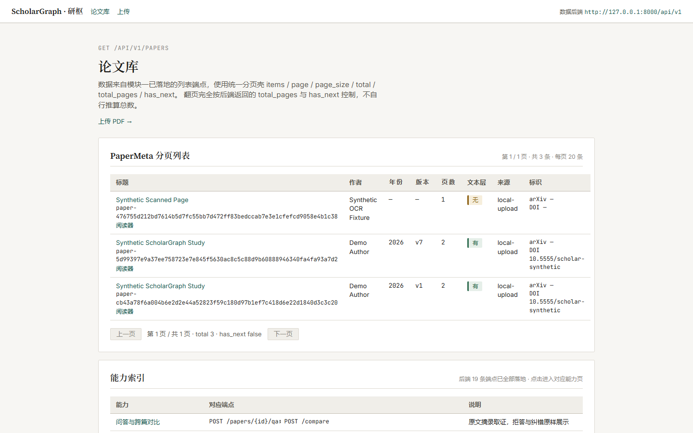
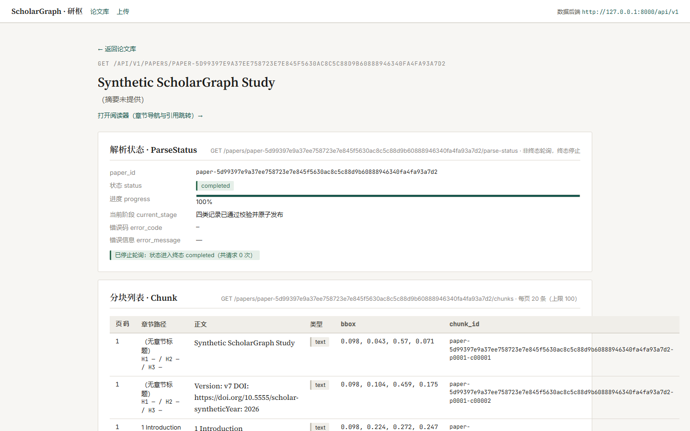
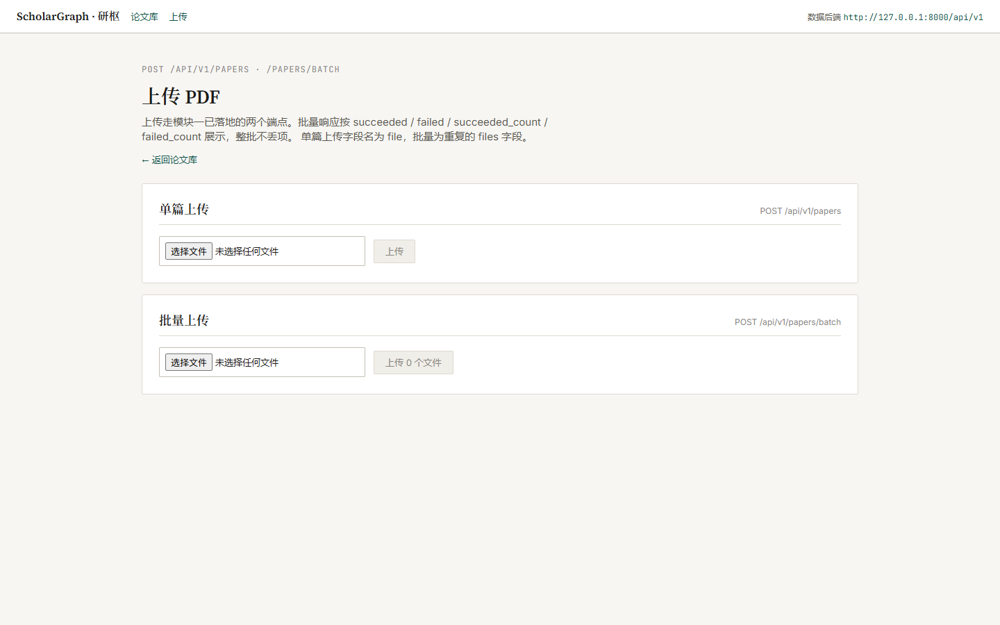
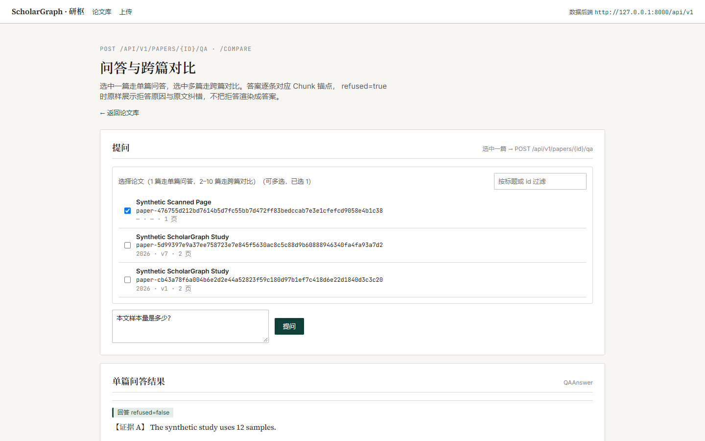
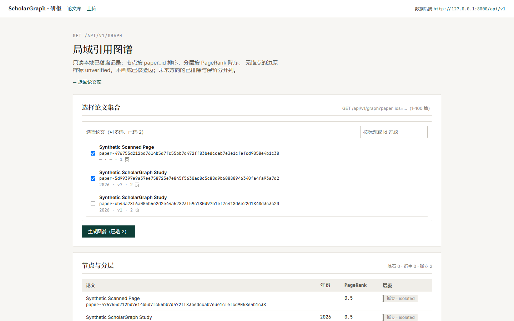

# ScholarGraph（研枢）

> **研枢 ScholarGraph：每一句回答，都能点回原文的那一页。**

科研助手 Agent 系统：面向论文 PDF 的解析、问答、图谱、综述与写作辅助的全栈 Web 应用。

当前状态：后端 **28 条业务端点**与前端 9 条路由已实现并可本地运行。官方三用例（v7/v1 去重、扫描 OCR、541 页长书）在宿主机与容器**两环境分别实测通过**；真模型六题 6/6 通过；语义向量去重、GROBID 容器全文解析（仅显式补充路径）、原文文件端点与 pdf.js 版式阅读、引用图谱身份解析、每日自动追踪调度均已落地并通过验收。最终 Docker 部署验收通过，快速回归层 148 通过。仓库名：`scholar-graph`；Python 包名：`scholar_graph`。所有路径和文件名使用英文。

仍保留的限制（详列见 [技术文档](docs/technical-document.md) 第十二节）：GROBID 默认上传/抓取路径未启用、reranker 二段精排未做、版式阅读为页级精度且仅官方 v7 实测、划词翻译与三维雷达图未实现、自由成文与文档导出未实现。在线演示地址（第⑧单补）。

## 快速开始

三分钟演示的逐步操作与每一步的预期画面见 [docs/demo-guide.md](docs/demo-guide.md)。

后端（仓库根目录 PowerShell，一条命令）：

```powershell
backend/.venv/Scripts/python.exe -m uvicorn scholar_graph.api:create_app --factory --host 127.0.0.1 --port 8000 --no-access-log
```

前端（另开一个终端，两条命令）：

```bash
cd frontend
npm install
npm run dev
```

浏览器打开 <http://127.0.0.1:3000>，点顶部「上传」传一篇 PDF，回列表点进详情即可看到分块与引用对应。

### 界面截图

以下均为本机真实运行截图（存于 [docs/images/](docs/images/)，由 Chrome 无头浏览器对当前代码页面截取，未修饰）：











### 已知限制

- **官方三用例未运行**：所有演示数据来自自制样例 PDF 与真实请求，不代表真实论文质量。
- **GROBID 待验证**：仅有 Mock 客户端测试，未调用真实服务，未拉取镜像。
- **问答为摘录式**：本地确定性原文摘录，不调用大模型；问法偏离会拒答并原样展示原因，
  锚点只保证「能点回原文那一页」，不保证语义正确性。
- 版式原文渲染与划词翻译未实现（分别待后端文件端点与模型接入），页面在对应位置明标。

## 架构图占位

TODO：按总指挥验收的模块边界补充架构图。

## 团队信息

| 项 | 内容 |
| --- | --- |
| 参赛选手 | 黄伟浩 |
| 院校 | 广州商学院 |
| 组别 | B 组个人赛 |
| 项目名 | 研枢 ScholarGraph |

## 目录骨架（当前实际结构）

```text
backend/       后端实现；scholar_graph 包、28 条业务端点与 README
frontend/      Next.js 15 前端；9 条路由（列表/详情/阅读器/问答/图谱/检索/写作/上传 + 同源代理）
contracts/     五类业务记录的 JSON Schema、合成示例与中文说明（零改动）
services/      服务集成预留；只有占位 README
docs/          API 草案、演示指南、开源组件登记表、技术文档与各项验收报告
prompts/       Prompt 实验区域
experiments/   实验区域
test-records/  跑测与用例记录
tests/         测试与验收脚本；tests/reports/ 存放各单验收报告与原始证据
fixtures/      测试样本预留；只有占位 README，PDF 被忽略
pdf/           官方测试用论文（被 .gitignore 排除，不入库）
data/          运行时数据目录（被 .gitignore 排除）
```

数据契约入口：[contracts/CONTRACTS.md](contracts/CONTRACTS.md)。API 清单：[docs/api-draft-v1.md](docs/api-draft-v1.md)。未被现有契约覆盖的数据结构在 API 草案中明确登记，不能由后续模块自行补充。技术文档见 [docs/technical-document.md](docs/technical-document.md)（PDF：[docs/technical-document.pdf](docs/technical-document.pdf)，实测 16 页）。各单验收报告与原始证据在 `tests/reports/`。

## 协作边界

总指挥（威龙）负责拆单与验收，用户负责工具间中转。Codex 为主力开发，本单仅建立骨架与契约；WorkBuddy 负责前端、文档和跑测；DeepSeek Harness 负责 Prompt 实验。工具不直接沟通，不越单补做其他工具的工作。数据契约的任何字段或语义变更必须先交总指挥裁定，再升版本并记录变更。

## 开源组件声明

以下为已定选型清单，本单未安装、接入、验证或打包这些组件；不表示相应能力已经实现。

| 组件 | 规划用途 |
| --- | --- |
| MinerU、GROBID、Docling | 文档解析与结构提取 |
| DeepSeek-OCR、PaddleOCR | OCR 识别 |
| PaperQA2、LightRAG、LlamaIndex | 论文问答、检索与知识组织 |
| LangGraph | Agent 流程编排 |
| pdf.js | PDF 浏览 |
| Cytoscape.js、Mermaid | 图谱与图示展示 |
| pandas、Matplotlib | 表格数据与图表 |

PyMuPDF 与 PDFMathTranslate 按本项目约定作为 AGPL 组件隔离使用，规划采用独立服务或独立进程边界，本单未接入。TODO：在后续文档单中补充组件实际版本、许可证原文链接、版权声明和隔离边界说明；此处不等于许可证核验完成。

GROBID 在 Compose 中使用官方仓库名 `grobid/grobid` 作为占位，镜像写法参考 [GROBID 官方快速开始](https://grobid.readthedocs.io/en/latest/getting_started/)。镜像版本、变体与摘要仍标 TODO，未下载或启动镜像。

## 复现指南占位

TODO：业务实现后补充依赖版本、安装、数据准备、启动、验证与结果复现步骤。

- `.env.example` 只有变量名，没有真实值；环境值的配置方式在后续实施单确定。不要提交 `.env`、API 密钥、真实 PDF 或本地数据。
- Docker 两服务构建配置已补齐，取代早期 scaffold 占位；使用方式与实际验收状态见下方“Docker 复现”。GROBID不包含在本轮两服务中，仍待单独联调。
- 结构验证使用 `docker compose config --quiet`；配置校验不等于镜像构建或运行验收通过。
- 合成示例只用于契约格式，不是真实论文、实验或功能演示。`.gitignore` 排除 `.env`、`data/`、PDF、node_modules 与 Python 缓存，fixtures 目录只跟踪占位说明。


## Docker 复现

前置：Docker Desktop已启动Linux引擎（或Linux Docker Engine）、Compose可用，8000/3000端口空闲；首次需要联网拉基础镜像、PyPI/npm依赖和OCR模型。目标平台为linux/amd64。无需宿主机Python、Node、venv、node_modules或API Key。默认无Key摘录式，真实模型测试无Key跳过。只启动项目可用一条命令：`docker compose up --build -d --wait`。

标准三条命令（仓库根目录）：

```bash
docker compose build --no-cache
docker compose up -d --wait
docker compose exec -T backend python tests/run_docker_acceptance.py --suite-only
```

预期：构建依照backend/pyproject.toml的ocr/test依赖与frontend/package-lock.json全新安装；启动后backend、frontend均healthy；后端<http://127.0.0.1:8000/api/v1/papers>返回分页JSON，前端<http://127.0.0.1:3000>可打开，其现有同源代理使用容器DNS backend:8000。前端源码不改，NEXT_PUBLIC_API_BASE_URL在Node构建时固定为内部地址。健康检查真实请求后端列表与前端代理，不添加业务端点。后端数据保存在本项目专属backend-data命名卷。

第三条在容器内执行全量回归（含实际OCR），再真实上传自制最小PDF并验证无Key问答带锚点；这是自制样例，不冒充官方三用例。Windows专属锁测试在Linux按原标记跳过；真实模型连通无Key跳过，均逐项报告。结果与JUnit写入/app/data/docker-acceptance/<run-id>/，终端打印报告路径和真实统计；通过为退出码0、passed=true，任何失败保留原因并非零退出。首次OCR模型下载计入容器实际耗时，不挂宿主机模型缓存。预计耗时取决于网络/CPU，本仓库不预报固定成功数字。

### 官方三用例：只读语料挂载

官方pdf/不随Git分发，也不进入镜像。需要全部官方验收时，先在终端设置SCHOLAR_GRAPH_PDF_DIR为现有语料目录（PowerShell例如`$env:SCHOLAR_GRAPH_PDF_DIR='D:/AI_Workspace/Tasks/scholar-graph/pdf'`，这不是Key）。使用**尚无论文数据的新Compose项目名**，执行下面三条命令：

```bash
docker compose -p scholar-graph-official -f docker-compose.yml -f services/docker-compose.acceptance.yml build --no-cache
docker compose -p scholar-graph-official -f docker-compose.yml -f services/docker-compose.acceptance.yml up -d --wait
docker compose -p scholar-graph-official -f docker-compose.yml -f services/docker-compose.acceptance.yml exec -T backend python tests/run_docker_acceptance.py
```

覆盖文件只把指定目录只读挂载到/corpus，路径不存在直接报错，不创建空目录；没有COPY语料。脚本要求真实Linux容器、无模型Key、初始后端论文数为0，依次上传1706.03762v7.pdf→v1.pdf、1706.03762v1_img.pdf、UnderstandingDeepLearning_02_09_26_C.pdf（541页）。不读取历史宿主机解析结果；实时HTTP调用当前后端，同步计时、采样容器内存，保存预警/裁决/差异、OCR文本与Chunk、长书分页/索引状态。OCR首次联网下载也包含在计时内。最后跑无Key摘录式问答。全量回归与三项业务分别统计，失败不写为通过。

若之前已用该项目上传过论文，脚本会拒绝复用；换一个新项目名并先停止旧项目以释放端口。可用`docker compose ... cp backend:/app/data/docker-acceptance/<run-id>/container-results.json ./tests/reports/docker-export-results.json`逐文件导出报告；JSON/XML逐个复制，不复制pytest临时目录的Linux符号链接，避免Windows符号链接权限错误；命令中的省略部分须替换为启动时相同的项目名及两个-f参数。不要用宿主机venv运行此容器探针。停止服务用相同项目参数执行`down`，默认保留数据卷，不自动删除用户数据。

.dockerignore排除pdf/、所有PDF、.env及其变体、.git、data/、venv、node_modules、.next、__pycache__和旧测试报告。构建使用显式COPY，无Key构建参数或环境透传；后端镜像包含自行安装的Node/TypeScript，供既有真实代理回归测试使用。GROBID、BGE-M3独立模型服务不在本轮两服务中，默认检索为词法。

本轮实际结果与干净克隆证明以[Docker验收报告](tests/reports/docker-reproduction-acceptance.md)为准；只有配置校验不能宣称换机复现通过。旧快速开始/限制中的“未运行官方用例、未接模型”为历史文案；宿主机后续官方修复和真模型实测见tests/reports/内对应新报告，容器结果独立登记。

## 第8项：部署配置与演示前预热（2026-10-30）

部署步骤、模型配置、端口与卷说明见[部署指南](docs/deployment-guide.md)。本轮实测与残留边界见[test-records/第8项报告](test-records/item08-20261030/README.md)。

1. 不存在本地 `.env` 时从 `.env.example` 复制；不存在 `docker-compose.override.yml` 时从 `deploy/compose.provider.example.yml` 复制。已有文件应合并，不能覆盖自己的配置。
2. 仅在本地 `.env` 填写真实 `DEEPSEEK_API_KEY` 与 `DEEPSEEK_MODEL`；override保留变量引用。凭据不入库，也不输出完整Compose展开配置。
3. 首次 `docker compose build`，再 `docker compose up -d --wait`；必须确认前后端healthy、前端能解析backend。
4. 修改Key或模型后用 `docker compose up -d --wait backend` 重新载入；检查只输出 `KEY_SET`／`KEY_MISSING`，再实跑摘要与全文翻译，不能把“变量存在”当作模型可用。
5. 演示前，对实际选择的论文运行 `scripts/warm_demo.py`。重启后需重新预热；脚本会记录真实首增量与校验后完成耗时，不会伪造流式内容。

```powershell
docker compose config -q
docker compose up -d --wait backend
docker compose exec -T frontend getent hosts backend
docker compose exec -T backend python -c "import os; print('KEY_SET' if os.environ.get('DEEPSEEK_API_KEY') else 'KEY_MISSING')"
backend/.venv/Scripts/python.exe scripts/warm_demo.py --base-url http://127.0.0.1:8030 --paper-titles "Attention Is All You Need" "BERT: Pre-training of Deep Bidirectional Transformers for Language Understanding" --question "BERT与Transformer Encoder是什么承袭关系？" --output data/demo-warmup.json
```

上例8030为本机主后端；全新安装默认8000。没有模型配置时翻译如实失败。向量不可用时明确标记词法回落；要强制验证hybrid预热可加 `--require-vector`。当前精排未上线，使用RRF；FlagEmbedding及模型许可待核。在线演示地址仍待实际部署。
