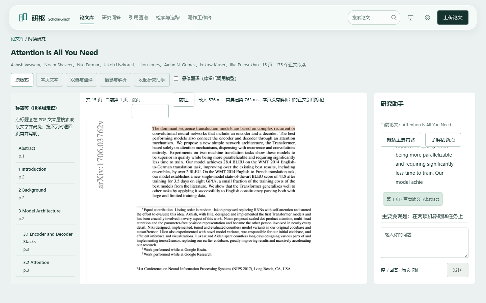

# 研枢 ScholarGraph 技术文档

## 每一句回答，都能点回原文的那一页

面向个人科研的论文管理、证据问答与写作工作台

| 项目 | 内容 |
|---|---|
|作者与参赛信息|黄伟浩 / 广州商学院 / B 组个人赛|
|版本日期|2026-10-30；对应本次提交总检查版本|
|公开仓库|https://github.com/hoanhkhai1hk-wq/scholar-graph|
|项目代码许可|MIT；第三方引擎和模型另行核查|
|在线演示地址|待实际部署填写|
|材料状态|本机实测与文档已整理；视频拍摄、云部署与正式提交另行推进|

**阅读提示**：本说明取代旧版技术文档的当前状态描述；旧文件及失败记录由Git历史保留。正文区分软件检查、真实模型案例、内容复核与尚未完成事项，不以接口存在或截图代替功能通过。

命题依据：项目内《科研小助手Agent-AI大模型.pdf》，第1.1–1.6节、测试数据、第3节提交要求与第4节评分表。原命题与测试论文不随公开仓库分发。本PDF遵守第3.3节“不超过30页”要求。

<!-- pagebreak -->

## 一、项目概述与问题

科研阅读包含一连串具体动作：找到论文、确认版本、理解实验与公式、比较多篇结论、返回证据、追踪新研究，再组织写作。单纯把PDF塞进聊天框，难以保留阅读位置、版本裁决和每个数值的原始出处。

研枢把原PDF作为最终核对对象。回答携带论文、物理页、章节和Chunk锚点；代码检查引文是否属于真实分块、数字能否回溯、输出结构是否完整。取证不足时解释原因并拒答，不把模型“认为正确”当作校验依据。

### 技术与应用创新

- **证据是产品结构的一部分**：锚点跟随答案、引用图谱、翻译与写作材料，点击后回到当前阅读器，避免在新页面丢失研究上下文。
- **草稿与最终回答分离**：真实模型增量可以显示处理进程；只有通过检查的final作为回答。流式连接事件不冒充模型内容输出。
- **原始材料与操作记录分离**：原件和冻结解析保持可追溯；元数据补正、版本选择、会话与任务单独保存，用户修正不覆盖来源。
- **研究闭环可回放**：从版本去重、引用关系到综述和图注，各自保留依据、失败原因、人工取舍与时间；没有取得全文的条目逐项列出。

这些是本项目的工程与交互设计，不宣称学术首创、算法最优或已经通过外部专家盲评。论文原文和术语保留英文，日常操作中文化。

### 当前产品外观

B「青瓷书页」以实体白阅读面承载长文，雾青环境色和局部半透明悬浮顶栏提供层次。动态和透明材质均可关闭，系统减少动态设置会停止持续动画。设计以读得清、找得到和等待时看得懂为目标。



<!-- pagebreak -->

## 二、需求分析与逐项状态

“通过”只表示所列报告的样本与环境；不是对全部论文、问题和网络条件的保证。

|命题|当前实现与入口|证据与限制|
|---|---|---|
|1.1 文件管理、去重、解析|论文库/上传；单批上传、版本提示、三种选择、修正、回收站；标准PDF、OCR、长书|第1项报告。自动公式LaTeX仍有符号错误，整体保留未通过；不能把人工修正当自动通过。|
|1.2 单篇与多篇问答|研究问答与阅读助手共用取证会话；原文锚点、数字校验和拒答|第2项固定题集：官方9/9；总固定题集14/14。不是独立随机评估准确率；后续普通中文概括/跨篇关系另有专项修复证据。|
|1.3 阅读与翻译|PDF原版式、标题树、引用往返、摘要/章节/选区/全文、划词/悬停、中译英、双向同步|第3项报告及第7项UI报告。文字层可高亮段落/引用区域；扫描件仅页级；字符级定位未实现。|
|1.4 获取、追踪、推荐|检索与追踪；真实arXiv获取、全部参考文献任务、依据筛选、日/周计划、反馈影响排序|第4项：40条中32取得 / 8未取得。完整下载验收未通过；启发式相关性不冒充独立质量评估。|
|1.5 图谱、综述、Future Work|选择论文构图、核心节点、限定集合综述、检索更新并排除已尝试方向|第5项：20节点 / 99关系 / 303依据 / 0孤立；仅所选集合，不能证明全球研究新颖性。|
|1.6 写作与绘图|idea框架、真实References、TikZ/DOT/Mermaid/Matplotlib代码；CSV表图、趋势图注、中文翻英|第6项和代码阅读顺序补修。TikZ只生成代码；图注由确定性计算回溯，不称为模型发现新结论。|

个人使用不触发“如果实现多用户”条件下的协同过滤要求，不将未做协同过滤自动判为个人版失败。所有明确功能仍留在验收范围内，不为提高通过率移除缺口。

### 三类官方样本口径

标准Attention v1与v7版本不混写。长书覆盖541页 / 6859 Chunk。本次OCR映射复查使用既有冻结样本15页 / 989 OCR Chunk；第1项优化后另一份记录为15页 / 1042 Chunk / 326.485秒。两者是不同解析批次，分块数不同不是数字覆盖或擅改历史。

<!-- pagebreak -->

## 三、系统架构与数据边界

```text
浏览器：中文工作台 / PDF.js / Cytoscape
   ↓ Next.js同源代理；可选评审访问保护
FastAPI：兼容v1契约 + v2工作台
   ├─ 可恢复任务、研究会话、逐文件状态
   ├─ MinerU / PaddleOCR / 可选GROBID
   ├─ 词法或BGE-M3 hybrid检索 → RRF
   ├─ DeepSeek真实生成 → 原文/锚点/数字/完整性检查
   └─ 图谱、综述、参考获取、调度、写作与CSV图注
数据：原PDF与冻结JSON + 独立SQLite操作记录
```

前后端职责分开：浏览器不接触模型Key；同源代理负责流式、文件Range与状态转发；后端决定材料范围、检索、验证和发布。v1调用与冻结记录保留，新能力通过v2扩展，避免为新页面改坏旧调用。

### 数据模型

|记录|用途与约束|
|---|---|
|PaperMeta|文件哈希、物理页、标题、作者、机构、来源及版本；上游未提供的字段留空，不能补猜。|
|Chunk|原文文本、页码、章节树、类型与来源；页数与Chunk数不是一一对应。|
|ReferenceEntry / CitationLink|文末书目身份和正文引用位置分别记录；无正文锚点时不假造位置。|
|QAAnswer|答案、事实证据、refused及数字核验信息；证据不足与错误前提需明确区分。|
|操作记录|元数据修正、版本选择、解析补齐、会话、翻译快照、反馈与任务审计，不覆盖原件。|

长任务提供queued/running/取消中/完成/部分成功/失败等真实状态。进度来自已处理材料，不使用计时动画伪造百分比。恢复后保留输入和已校验结果，失败项可重试；用户无需从头猜测发生了什么。

### 实际选型

前端依赖Next.js、React、PDF.js、Cytoscape；后端FastAPI、MinerU、PaddleOCR、Matplotlib、LangGraph等。准确版本以pyproject.toml、requirements-retrieval.txt、package-lock.json和Dockerfile为准。本地向量运行时与OCR依赖隔离，避免冲突；大模型生成使用远端DeepSeek，不称为大模型已本地部署。

<!-- pagebreak -->

## 四、AI方案：选型、集成与校验

### 文档处理

先识别文字层与物理页，再由本地解析/OCR获得细粒度分块；GROBID用于书目与结构增强，失败须留下回落原因。选择这些引擎是为兼顾科研PDF的结构、扫描页与长书，而不是把多种工具名称列出来作为多模态能力证据。公式与图表识别需独立内容核对，源图可读不等于LaTeX完全恢复。

### 检索增强问答

词法路径承担无向量环境的可用性；准备本地BGE-M3时进行dense/词法等召回并以RRF融合。查询按所选论文隔离，跨篇问题不能把一篇材料的证据冒用到另一篇。最终返回实际检索方式和回落原因，词法回落不能标hybrid成功。

当前cross-encoder reranker未上线，现行RRF。代码保留受限精排实验，但CPU预算内未满足要求；第8项向量模型常驻只减少重复加载，不意味着精排已部署。FlagEmbedding与模型许可证待核。

### 模型与Prompt

DeepSeek用于真实取证回答、翻译和生成性写作。后端先确定论文、源段与范围，再提交材料；Prompt区分原文事实、跨篇推论与研究设想，不允许编造实验结果。无Key或上游失败必须报错，不用模板摘录冒充真实翻译。

写作框架把已有贡献和待验证想法分开。当模型修复返回完全相同草稿时，按纠正路径重新生成，不关闭校验以换取成功。翻译采用稳定源段ID与保护占位，保留已识别的代码、公式和HTML代码块；完整性检查包括漏段、重复、重排与空白。

### 编排与工具边界

现有LangGraph取证路径及工作台任务编排使检索、生成、验证可审计。后端受控函数执行解析、下载、图谱与绘图；这不等于开放任意工具给模型自主运行，也不声称所有功能均由多个独立智能体协同决策。拓扑图模型提取节点关系，脚本由确定性模板生成，不执行任意模型Python代码。

### 校验能证明什么

锚点必须指向真实材料，引用片段必须可匹配；数字检查核对源值、参数归属及受支持的单位/差值。它们能发现部分幻觉和错误，但不能普遍证明自然语言语义、因果推断和实验结论正确。固定官方题另做逐题源文复核。

<!-- pagebreak -->

## 五、核心实现：管理、问答与阅读

### 内容去重与版本裁决

先传v7再传v1，按内容、论文身份与版本识别同一工作的不同版本；两文件字节并不相同。界面提示库内更新并建议保留已有，仍允许使用本次或保留两份，选择和历史可恢复。原件保留，修正和裁决单独存储。

当前无BGE环境保留文件哈希、身份与词元相似等路径，不能把它称为已测向量去重。旧语义去重实验与阈值记录保留，不将内部小样本校准当独立准确率。

### 单篇与多篇取证

问题进入同一研究会话，带上明确论文范围。回答引用可在阅读器中展开并点击；无证据问题合法拒答，但普通中文概括和“他们有什么关联”应先取得各论文材料，不能因英文关键词未重合就一律拒答。相关缺陷已在问答专项提交修复。

对比问题逐篇保留证据，综合部分区分并列观察和推论。数值比较回溯原始操作数，不由模型自由编造差值。模型token草稿先于验证完成，不应当作可引用的最终结论。

### 阅读导航与翻译

保留PDF双栏、表格和公式原版式。章节树定位文本层段落，正文引用跳文末，再恢复来源位置和高亮；找不到文本时明确回落物理页。扫描PDF没有原文字层，只有页级定位说明，不把OCR分块坐标说成真实字符定位。

摘要、章节、选段和全文为不同范围；划词/悬停真实连接翻译端点。中译英只支持规定范围，中文全文来源必须确为完整快照，不能拿摘要译文冒充全文。双语两栏按源段对应，用户拖动任意一侧时另一侧跟随；末尾钳制与误差在原报告中留证。

不完整译文显示段落校验原因，导出禁用并有函数检查；完整结果可导出Markdown。原始论文、完整译文和个人会话不因公开代码仓库而公开。

<!-- pagebreak -->

## 六、核心实现：发现、图谱与写作

### 获取、追踪与推荐

按标题从实际arXiv源检索并取得唯一身份后下载入库；参考文献任务对每项记录已有、成功、无法唯一匹配或解析失败，不把一键提交等同于全部下载成功。当前主要为Atom轮询和本地持久调度，没有实现OAI-PMH/arxiv.py独立通道。

内容筛选利用引用上下文、章节和采用/背景等线索，输出依据供用户选择，不能判断作者“为了引用而引用”的动机。推荐说明相对库中哪篇论文的关系，保留代码链接依据；反馈会重新排序。已有同库缓存优化不缓存用户反馈结果，新增或修正材料会失效。

### 引用网络与核心节点

图边方向为引用方→被引方，按不同论文关系去重。PageRank用于所选集合的核心/衍生判断；只有书目身份依据时明确标注，不能伪称正文引用。图谱实测20节点 / 99关系 / 303依据 / 0孤立，其中正文位置与书目依据区分，排名可用另一种求解方法复核。

综述限制所选论文集合并校验引文，真实外部论文不能无提示混入集合内引用。Future Work检索更新研究并保存检索时间、年份、排除/纳入/不确定理由。排除已尝试方向的样本通过，不表示世界上没有尚未检索到的同类工作。

### 写作与图表

输入idea产生Abstract、Introduction、Related Work和References等框架，标注研究设想而非虚构完成结果。参考文献核对为两次生成6条记录 / 3篇唯一论文，作者、标题与年份来自真实论文。有限样本通过不保证任意idea均不出错。

同一节点/关系结构输出TikZ、Graphviz DOT、Mermaid和Matplotlib；后三者有真实渲染证据，TikZ按本项要求只生成代码。CSV输出表格、折线、柱状及三维雷达等图，核心趋势、首末值和差值由确定性代码计算并回溯源单元格。三维外观不能自动证明数据具有额外物理维度。

中译英测试使用明确标注的自编中文控制稿：2页 / 21/21 Chunk / 5.922秒，不能称作已发表中文论文。代码跨分块顺序缺陷在独立补修提交中修复，见code-order验收；第6项原始失败记录仍保留。

<!-- pagebreak -->

## 七、Source Tracing与抗幻觉边界

```text
原件SHA与物理页
 → 冻结Chunk及书目/引用关系
 → 检索选用的源段
 → 生成时的证据标识
 → 字面/锚点/数字检查
 → 经校验final
 → 当前PDF页与高亮
```

### 三种容易混淆的结果

|结果|界面应表达|不能推断|
|---|---|---|
|取证成功|展示回答与可点击出处|自动证明整篇论文结论正确|
|当前检索不足|说明范围/原因，可重试或检查解析|论文中绝不存在该内容|
|错误前提|按证据纠正前提，拒绝无依据计算|捏造一条“否定事实”的原文锚点|

公式/代码保护证明已识别保护片段未被翻译改写，不能证明每个扫描图内公式都已正确识别。图谱依据核查证明本集合关系，不能证明因果贡献或全领域学术价值。

### 数据安全

Key仅后端环境，公开模板为空值/变量引用；不打印完整环境或Compose配置。原始PDF和完整论文译文不入Git；测试证据只保留必要摘要、SHA、步骤与截图。公开仓库扫描包括当前跟踪文件、全部可达Git blob/commit/tag及PDF提取文字；本地忽略的.env用于配置，不作为公开内容“零Key”的假证明。

人工补正、系统裁决、原始解析和模型结果来源可区分。HTML在渲染前清洗，模型凭据不交给浏览器。评审模式应使用隔离演示库和专用访问码；本机访问控制测试不能替代云端HTTPS与外网安全验收。

### AI协作与作者责任

作者负责需求、选型、交付与最终复核；AI辅助代码、测试、文档和源文校对。当前内容复核由本助手完成，不伪称独立人类专家评审。功能实现、规则回溯、模型质量和科研有效性分别说明，代码测试通过不是学术结果验证。

<!-- pagebreak -->

## 八、性能优化与真实取舍

|指标|同一口径实测|依据|
|---|---|---|
|长书首次解析|1225.453→226.625秒|第1项，本机单次，冻结内容不变|
|长书首屏|4.783→3.754秒|第8项，真实浏览器各3轮中位数|
|跳第300页|24.265→2.576秒|同上，等真实canvas与页码|
|跳第541页|2.871→1.362秒|同上，末页可读|
|API冷读|1514.874→2017.087毫秒|第8项单次；退步如实保留|
|全冷→已预热对比|563.427076→8.526629秒|真实首内容增量；不是SSE连接事件|
|重启后预热命令|首增量37.889150秒 / 完成45.404005秒|CLI实跑；需重新支付首次加载成本|

长书服务端以源数据签名复用阅读材料和导航，增量解析及元数据变更会失效；前端消除首屏同页重复取数。物理页定位用立即跳转，防止平滑滚动途经大量页面触发渲染和目标漂移。PDF仍按需加载，没有删后半本或把原件改成纯文本。

对比冷启动的主要问题是实际向量模型/索引准备和重复进程加载。仅提前建索引不足，新增常驻进程复用真实BGE-M3后改善。它不缓存虚构答案，不绕过最终验证，也没有在CPU超预算时悄悄标成精排成功。

### 性能适用范围

第8项性能栈后端1.25 CPU/3 GiB、前端0.75 CPU/1 GiB；Chrome在宿主运行，其他容器存在，不能称为独占2核4G云机。所有耗时包含特定样本、服务状态与同机负载，不是SLA、国内公网延迟或多用户承载能力。

API冷读单次退步、先前错误测量脚本、恢复前失败、OCR图表页低相似度均保留。预热只覆盖所选论文；重启和新增材料需重新准备。演示前步骤写入README，不能把一次验过当作下次开箱即用。

<!-- pagebreak -->

## 九、测试与验收证据

测试分层：快速单元/契约回归用于防回退；相关全量检查覆盖必要模块；真实服务记录模型、网络、OCR和任务；真实浏览器验证用户点击、滚动、导出、重试与原文高亮；内容质量再做源文核对。每层证据不可互相替代。

|验收对象|实测结果|报告|
|---|---|---|
|官方问答题|官方9/9；总固定题集14/14|第2项逐题表与原始响应|
|最终快速层|200通过 / 0跳过|第8项fast-final.xml；未选项不算已测|
|相关全量层|430通过 / 0跳过|第8项related-resumed.xml；真实模型/OCR门禁开启|
|OCR重新匹配|15/15页匹配；13/15页过相似度门限|第8项原失败与单独映射复核均留存|
|默认Compose摘要翻译|1/1段 / 2.815362秒 / 缓存0|全新隔离卷，真实DeepSeek|
|默认Compose全文翻译|175/175段 / 59.067831秒 / 缓存0|同上，段落完整性不等于逐字质量评级|

### 浏览器与异常

第7项覆盖1440×900、1366×768、1024×768、390×844，检验导航、真实状态、键盘焦点、表格与阅读布局；第8项恢复后另测主要页面、研究助手真实生成及原文定位。截图证明可见状态，操作断言证明业务行为。

翻译错误通过隔离transport故意返回空段落，仅验证失败保护，不能算真模型质量通过。追踪和抓取通过真实不可达代理制造连接失败，最终显示失败原因与重试。成功翻译来自另一真实模型环境，两类结果分别标记。没有假成功论文、假译文或静默失败。

### 报告之间如何核对

实测数字清单为docs/submission-metrics.json，逐条给出源文件、字段或原文抽取规则及对应报告。生成脚本重新读取证据，数字变化需补文档小patch。只引用可核查批次，不拿旧报告的题数、扫描Chunk或构建页数覆盖本次结果。

<!-- pagebreak -->

## 十、安装、部署与演示就绪

### 代码与环境

仓库公开，main保留逐项提交与修复历史，不压扁失败。README包含项目介绍、架构、安装运行、团队与一句话定位。后端pyproject、独立向量requirements、测试依赖、前端package及lock、文档构建依赖分别入库。

.env.example提供后端模型、端口、数据、检索和可选评审环境模板；真实.env和个人override忽略。Dockerfile从源码构建，包含预热脚本；本机增量镜像仅是本地验证，不写成云端已可拉取。

```text
复制.env.example → 本地填写Key与model
复制provider override示例 → 保留变量引用
docker compose config -q
首次build → up -d --wait
检查healthy / backend DNS / KEY_SET与MODEL_SET
实跑摘要和全文翻译 → 预热所选论文
```

更换Key后up -d backend重新载入，单独restart不更新容器环境。默认前端/后端为3000/8000；当前工作站主后端8030，验收体验3400为独立库。只绑定本机，不能把本地地址当公网演示地址。

### 视频与云端范围

视频脚本规划6分50秒，普通话，MP4不低于1080p；成片必须落在5–8分钟，拍摄后再实测时间与哈希。大纲展示锚点溯源、拒答、图谱、去重、追踪、翻译与写作，解释与通用聊天网页的工作流差别，不贬低未实测竞品。

云清单列域名、HTTPS、专用访问码、隔离演示库、资源限制、流式/Range代理、备份恢复、国内网络验证和评审期维护。视频拍摄和云部署本身由作者另行推进，未填写虚假公网地址、账号、可用率或延迟。

在线演示地址：**待实际部署填写**。此时只能判断文档侧就绪，不能判断命题第3.4节已交付，也不能宣布整套参赛材料齐全。

<!-- pagebreak -->

## 十一、开源组件与诚实保留项

本项目代码MIT不覆盖依赖、字体与模型。实际运行清单以锁定依赖为准；open-source-register.md是早期选型与核验登记，并非表中所有组件均已接入。当前真实OCR主要为PaddleOCR，不把DeepSeek远端生成服务说成DeepSeek-OCR部署。

MinerU用于文档解析，PaddleOCR用于扫描识别，GROBID为可选增强；PDF.js用于原件阅读，Cytoscape用于图谱，Matplotlib用于图表。实际版本与许可证、权重和传递依赖的审核是不同事项，不凭包名推断全部许可已完成。

**FlagEmbedding与BGE-M3模型许可证仍待核**。现有本机实验可运行，不表示已核准打包或云端分发。本文不把进程隔离自动解释成满足任何开源许可的充分条件。

|保留项|当前边界与下一步|
|---|---|
|扫描定位|仅物理页；图表旋转文字可能识别错，保留原图。字符级未实现。|
|公式自动提取|自动LaTeX仍有符号错误；人工校对样本单独记录，继续完善再实测。|
|参考全文|部分文献未取得唯一匹配arXiv全文；报告逐条失败，补其他合法来源后复验。|
|reranker|cross-encoder未上线，当前RRF；常驻向量不是二段精排。|
|对比冷启动|仍需预热，新增论文与重启后重新执行，缺向量诚实回落。|
|许可|FlagEmbedding/权重及传递依赖待核，不宣称合规审查全部完成。|
|推荐与未来方向|启发式与有限样本，未独立评估全域质量或证明科研新颖性。|
|线上交付|视频、云HTTPS、国内可达性和评审期稳定运行待实际推进。|

<!-- pagebreak -->

<section class="scores">

## 十二、评分口径与证据映射

### 命题PDF第4节评分表

|维度|权重|证据与限制|
|---|---:|---|
|AI技术深度|35%|解析/OCR、RAG、受控编排、验证与本地向量；远端生成不称本地大模型，未夸大多智能体自治。|
|创新性|15%|证据定位、草稿/最终分离、版本裁决、可审计图谱与研究闭环；不声称学术首创。|
|产品功能和工程质量|30%|模块入口、回归、状态、恢复、Docker及历史；公式和部分全文缺口保留。|
|用户体验|10%|B方案、中文操作、四尺寸、骨架、失败提示、当前阅读器联动；公网性能待验。|
|实用性|10%|个人科研从导入到写作；真实来源和可追溯输出，未以软件测试证明研究成果。|

合计100%。权重直接来自本机命题原页；第3.3节30页限制来自第6页图表，纯文字提取会漏掉，已按原页纠正旧文档说明。

### 历史转达的赛道a–f细项

来源：旧技术文档及2026-10-26补丁报告登记的“用户2026-10-25提供赛道详情截图”。本轮未取得该原始截图二次核对，保留登记口径，不假称来自本次命题PDF。

|细项|权重|登记的子项与分值|
|---|---:|---|
|a Agent与大模型技术深度|35|编排9；抗幻觉RAG溯源8；多模态解析7；Function Calling6；Prompt与Guardrails5|
|b 科研创新|25|图谱与Future Work10；语义去重与版本差异8；交互创新7|
|c 工程|10|代码质量4；Docker复现3；鲁棒与内存3|
|d 闭环|10|场景贴合5；测试通过率5|
|e UI/UX|10|界面与可视化4；联动体验3；AI思考可视化3|
|f 价值|10|学术价值5；开源推广5|

合计100。两套维度与权重不同，不互相替换或相加，不填写预测分或把固定案例通过率当自动得分；最终以组委会最新解释为准。a–f原图复核状态仍明确保留。

</section>

<!-- pagebreak -->

<section class="metrics">

## 十三、数字索引、提交材料与展望

下表每项可由机器重新读取真实证据；所有耗时均限定批次、样本与环境。没有记录的性能或质量数字不估算。

|编号|口径|实测值|
|---|---|---|
|M01|长书覆盖|541页 / 6859 Chunk|
|M02|长书首屏|4.783→3.754秒|
|M03|跳第300页|24.265→2.576秒|
|M04|跳第541页|2.871→1.362秒|
|M05|API单次冷读（退步保留）|1514.874→2017.087毫秒|
|M06|全冷→已预热首内容增量|563.427076→8.526629秒|
|M07|重启后首次CLI预热|首增量37.889150秒 / 完成45.404005秒|
|M08|本次扫描件冻结样本|15页 / 989 OCR Chunk|
|M09|OCR物理页匹配与额外文本门限|15/15页匹配；13/15页过相似度门限|
|M10|新库真实翻译 abstract|1/1段 / 2.815362秒 / 缓存0|
|M11|新库真实翻译 full|175/175段 / 59.067831秒 / 缓存0|
|M12|所选图谱|20节点 / 99关系 / 303依据 / 0孤立|
|M13|快速回归|200通过 / 0跳过|
|M14|相关全量回归|430通过 / 0跳过|
|M15|问答固定题集|官方9/9；总固定题集14/14|
|M16|参考文献获取|40条中32取得 / 8未取得|
|M17|长书首次解析前后|1225.453→226.625秒|
|M18|扫描件前次优化样本|15页 / 1042 Chunk / 326.485秒|
|M19|中译英原生中文全文|2页 / 21/21 Chunk / 5.922秒|
|M20|写作参考文献核对|两次生成6条记录 / 3篇唯一论文|

字段、原始路径、派生规则与报告位置见[submission-metrics.json](submission-metrics.json)；第1–6项及第8项报告、代码顺序专项和UI报告均保留原始失败，不为本版重写历史结果。历史技术文档验收报告只描述历史批次，不作为当前页数或当前功能状态证明。

交付文档：[提交总检查](提交总检查报告.md)、[演示视频脚本](demo-video-script.md)、[云部署清单](cloud-deployment-checklist.md)、[部署指南](deployment-guide.md)。代码提交、公开推送、视频拍摄和比赛官网提交是不同状态。

后续优先补自动公式内容准确性与未取得全文的合法来源，完成许可证和公网全链路，再以新的源文题集和真实外部评审检查泛化质量。只有待验事项逐条具备证据，才可改成“完全符合”。

</section>
