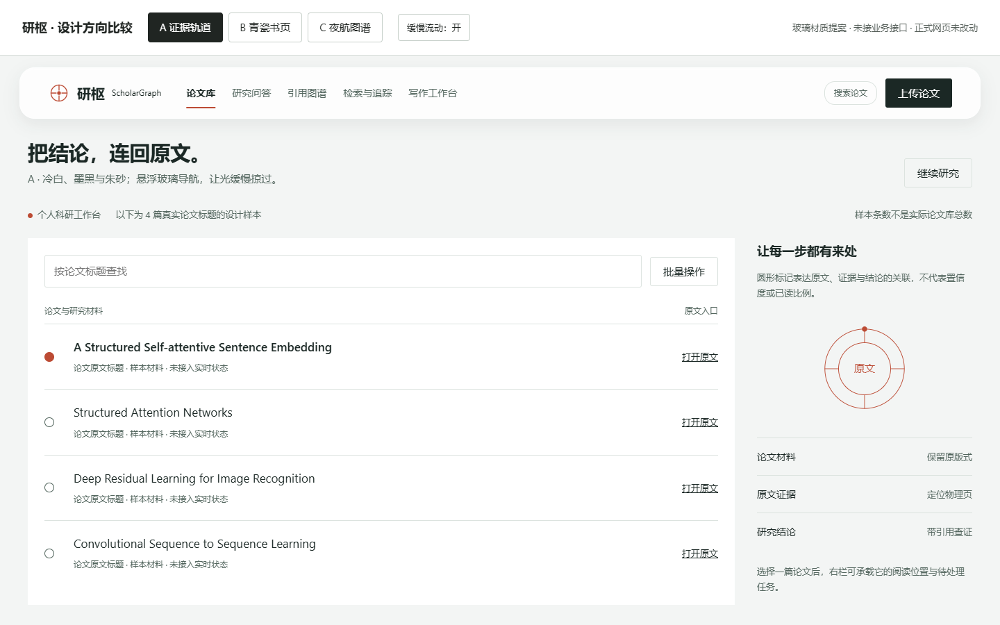
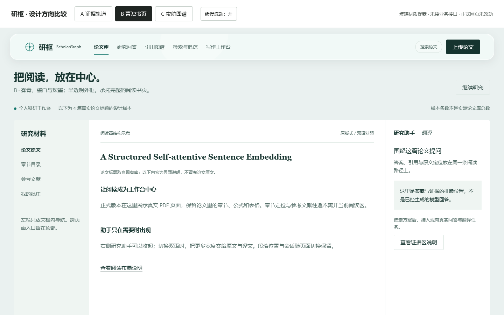
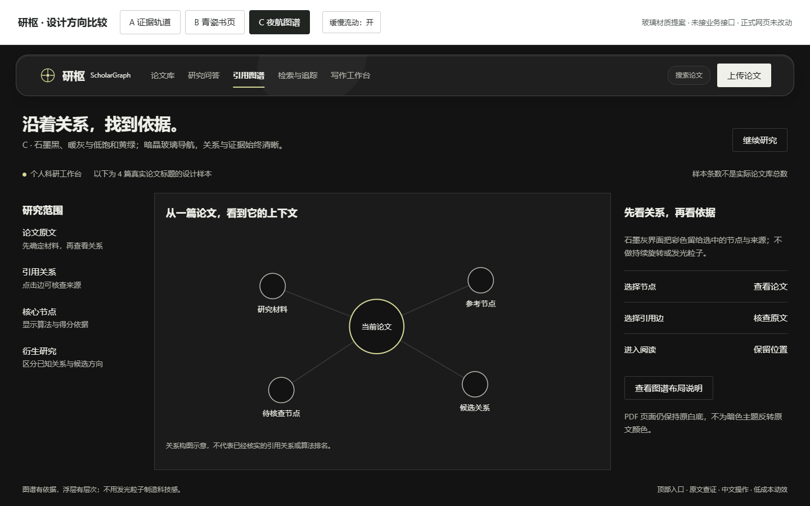

# 研枢 ScholarGraph：三个界面设计方向

日期：2026-10-29。阶段：**用户已选择 B「青瓷书页」，实施结果见文末与验收报告**。

本文件保留先前提案和改前审计记录。用户随后明确回复“B”，已按该方向实施；既有业务、数据与未提交工作保留。

**本轮新增设计授权已纳入**：可以使用液态玻璃、悬浮、半透明与缓慢流动；顶部导航借鉴所给B站视频。三份预览已更新为这个材质方向。这里的“静态预览”指未接业务接口，不表示没有动效；可直接切换“缓慢流动”开关。

## 先看三个方向

[直接打开动态预览](http://127.0.0.1:3480/ui-design-preview.html)，或[打开本地文件](ui-design-preview.html)。3480只在本机监听，是独立的提案预览，正式站点仍使用原入口。预览支持切换方向、筛选样本、开关缓慢流动和查看说明；没有接入业务接口，按钮不会上传论文、调用模型或修改库。4篇标题取自现有论文库，样本数量不是实际库统计；图谱连线仅示意布局，不是已经核实的引用关系。

| 方向 | 视觉印象 | 布局重心 | 适用偏好 |
|---|---|---|---|
| **A 证据轨道，推荐** | 冷白、墨黑、朱砂；悬浮清玻璃导航、细圆环与证据路径 | 论文列表 + 来源侧栏，阅读、证据、结论贯通 | 希望新颖、有记忆点，同时保持科研工具的清楚与可靠 |
| **B 青瓷书页** | 雾青、瓷白、深墨；半透明玻璃外框与实体书页 | 阅读器为中心，章节、原文、助手围绕当前论文 | 每天长时间阅读，希望安静、舒适、易用 |
| **C 夜航图谱** | 石墨黑、暖灰、低饱和黄绿；暗晶玻璃导航与关系画布 | 图谱与关系核查为中心，材料和证据分居两侧 | 希望图谱演示更醒目，偏好暗色研究工作台 |

推荐A：它把本项目真正的特点“结论可以回到原文”变成视觉与交互主线，适合评审快速理解，也能延续到阅读、问答、检索和写作。B更适合阅读优先；C更适合图谱探索优先。以上是设计判断，不是性能或获奖预测。

## A：证据轨道

**核心章法**：让论文、原文证据和研究结论有一条可追踪的路径。圆形母题只表达关系或真实浏览进度，不冒充答案置信度，不用同心圆代替实际内容。

**配色**：背景`#F3F5F4`；内容面`#FFFFFF`；正文`#1B2825`；次级正文`#53665E`；证据强调`#BC4B34`。黑色主操作、细边次操作、文字操作分层；朱砂用于证据选中和关键关系，错误仍用独立语义状态与文字解释。

**布局**：常驻顶部主导航，工作区使用宽列表和约310px来源侧栏，不继续首页功能卡片墙。外侧40px留白，内部24/32px间距；大标题控制在30px左右，首屏优先呈现论文和当前操作。圆角是局部规则，不把所有对象包进相同阴影卡片。

**玻璃与流动**：导航离页面边缘留出距离，使用半透明底、单层背景模糊、细亮边和小范围软阴影；一条低对比高光约26秒缓慢移动。内容区保持实体白底，证据文字不随高光移动。液态感来自材质层次，不做每帧折射模拟。

关键页面：

- 论文库：首屏直接搜索和阅读；一条论文以原文标题、作者、年份、解析状态为主。行内保留“阅读”和“提问”，编辑、版本、恢复等放入明确的二级操作，批量能力完整保留。
- 阅读器：顶部切换全局模块；左侧是本篇章节和参考文献；原文为主区；右侧研究助手可收起。点击证据只定位当前原文，不额外开一张重复阅读页。
- 问答：问题与答案居中；材料范围始终可见，来源侧栏展示证据而不是调试日志。没有证据时解释“未检索到”及当前范围，不能当成已答成功。
- 图谱：节点与边使用同一套圆形语言；选中边后侧栏显示引用原文与核查入口，排名同时显示计算依据。
- 检索与追踪：以结果列表和真实任务轨迹为主，区分“未发现新增”“查询失败”“解析失败”；点赞、点踩保留。
- 写作：研究想法、真实引用与生成内容分区；预览/脚本/下载使用有区别的按钮层级，代码与图表不被装饰卡片压缩。

可选的阅读圆环：放在阅读区底部的独立安全位置，约44px，显示“已浏览页数/总页数”；只按实际访问的唯一物理页计数，不把翻到最后一页当作读完整本，不声称衡量理解程度。作为本方向的可选细节，不扩大命题验收范围。

## B：青瓷书页

**核心章法**：把研究助手放在书页旁边，而不是把论文塞进一个聊天窗口。用浅色外框与完整书页建立层级，正文留白服务阅读。

**配色**：外框`#EAF1F0`；书页`#FFFFFF`；正文`#16342F`；次级正文`#506A64`；选中关系`#14766C`；批注底`#EFF5F2`。青绿与旧深松绿有连续性，但不继承旧卡片编排、按钮与圆角规则。

**布局**：顶部主导航不变；阅读器是约215px章节列 + 可伸缩原文列 + 300px助手列。书页仅一层容器，无多重阴影嵌套。平板收起章节并把助手转为可切换面板；手机在原文、目录、助手间切换，并保留位置。

**玻璃与流动**：采用带青色环境色的悬浮顶部导航和轻透明工具层；PDF书页不透明。动态只发生在导航的高光层，翻页和选区周围以短暂反馈表达动作，不能让整篇论文漂浮晃动。

关键页面：

- 论文库：像研究材料目录，用列表与选中文档预览组织；缩略图只来自真实PDF，不生成假的论文封面。
- 阅读器：本方向最重要的页面。原版式、正文、双语切换位置固定；选区翻译在附近出现，助手关闭后原文获得宽度；引用跳转与准确返回继续保留。
- 问答：以本篇或本组材料为中心，明确区分原文、译文和回答；证据片段与来源页并排，减少频繁离开阅读器。
- 图谱：白底关系图，保持同一细线与选中强调；侧栏做来源索引，不变成五彩圆球墙。
- 检索与写作：检索是资料目录，写作是文稿编辑区；状态与草稿保留，研究材料在边栏可查。

取舍：阅读舒适度更高，第一眼冲击相对A/C克制；会用实际章节、引用往返和双语排版体现完成度。

## C：夜航图谱

**核心章法**：把研究关系变成可核查的探索空间。暗色服务图谱观察与夜间工作，不能靠发光、粒子或持续旋转制造“科技感”。

**配色**：背景`#131313`；工作面`#1B1B1B`；正文`#F0F0EA`；次级正文`#B5B5AD`；选中与关键关系`#D4D796`；边线`#393939`。使用中性暗色，不采用紫蓝渐变或藏蓝霓虹主题。

**布局**：顶部主导航 + 研究范围列 + 中央关系画布 + 证据检查列。选中节点时只强化这一条关系，其他节点退到背景；不让全图和所有按钮同时高亮。

**玻璃与流动**：暗色玻璃导航使用较高不透明度保障对比，边缘微亮而非霓虹；背景仅有局部慢速高光，不为整个图谱增加持续运动。节点关系在停止交互后保持稳定。

关键页面：

- 图谱：一眼看到研究范围、当前节点与来源检查。边有方向、类型和出处；算法分数、孤立节点、核心/衍生节点有文字说明，不编造排名。
- 论文库：暗色材料列表，选中论文在侧栏显示真实摘要和阅读入口；不复制交易行情看板的KPI或涨跌数字。
- 阅读器：工具外框可以暗色，PDF仍是原来的白底与字体，绝不对原文做颜色反转；双语文字可独立适配。
- 问答：答案、证据和缺失状态在暗色上保持足够对比；技术诊断折叠，错误不能只用红/绿区分。
- 检索与写作：保持同一工作区，图表颜色语义一致；代码下载、图注与真实参考文献继续可达。

取舍：图谱演示更突出，但暗色主题要逐页检查表格、HTML译文和图表对比，落地工作量更高；不会把“更暗”当成“更高级”的替代品。

## 三个方向共同执行的功能底线

| 必做项 | 当前实况 | 选定后的具体交付 |
|---|---|---|
| 1 顶部常驻导航 | 五个模块已在左侧，尚无顶部全局导航 | 顶部常驻“论文库、研究问答、引用图谱、检索与追踪、写作工作台”，上传为主操作；设置可达。左栏只在需要时承担文档或任务内导航，不重复整套全局入口。手机菜单能关闭、键盘可达、焦点能恢复 |
| 2 中文操作 | 多数已中文化，仍有内部状态与字段泄露 | 导航、按钮、提示、空状态、失败原因均中文。论文标题、摘要、原文、代码及`Chunk`、`hybrid`、`mineru+grobid`等技术术语不被翻译或改写 |
| 3 诊断折叠与标题 | 已有`Diagnostics`，但论文详情的解析状态等仍在正文暴露端点、字段 | 诊断默认收起且保留真实内容；章节标题不附内部英文类型。论文标题的英文属于原文，不删除 |
| 4 骨架屏 | 5个路由有`loading.tsx`；论文库客户端还出现纯文字等待 | 覆盖解析、问答、图谱、检索的路由等待与内部异步请求。固定版面灰色占位，复用旧结果时不清空页面；真实进度、取消与重试保留，不用假百分比 |
| 5 空状态 | 已有`EmptyState`，不能当成全部未做 | 分别设计论文库空、检索无结果、追踪无新增的图示与下一步；不能把下载失败伪装成无新增。图示用自绘几何SVG，不能用emoji或无关图库照片 |
| 6 视觉与布局 | 本文三个方向尚未选定 | 按选择统一页面、控件与状态，不只换首页颜色；不强制Bento，也不堆同款圆角阴影卡片 |
| 7 旧提示回归与截图 | 当前十个访问场景未检测到旧错误翻译提示；不是所有展开状态的完整业务验收 | 实现后展开阅读侧栏、实际划词和悬停翻译复测；全部页面与状态截图进入`docs/images/`，避免只做静态搜索 |

导航和原版式规则按本轮最新指令执行；不再让历史“左侧悬浮导航”要求阻止顶部常驻入口。

## 等待、跳转和低配置演示机

- 视频导航借鉴“左品牌—中模块—右搜索/工具”的三区结构、紧凑高度和当前模块下划线；个人科研版把账户区域转换为设置/服务状态，不为模仿外观增加多用户系统。桌面悬浮，滚动持续可达；手机正式实现使用可关闭菜单，预览暂用内部横向导航条展示五个入口。
- 液态玻璃是用户明确新增的设计要求，优先于技能默认“禁玻璃/禁悬浮胶囊”规则。保留禁止廉价紫蓝渐变、emoji图标、全站同款阴影卡片、按钮无层级这四条底线。
- 预览仅在顶部导航使用一层`backdrop-filter`：桌面14px、手机8px；高光通过CSS变换缓慢移动。模糊数值是预览参数，不是2核4G性能合格结论。正式实现可根据实测降低或转为高不透明度磨砂层。
- 提供关闭动态与减少透明度的路径；无背景模糊支持时退回实体底色，减少动态偏好下停止高光位移。正式版还需验证后台标签页停动和低性能降级；本轮不预先宣称已经实现。
- 切换路由先显示顶部框架、页面标题与对应骨架；不加人为最低等待时间，不用动画掩盖失败。
- 小范围过渡只用于焦点、侧栏、页码和证据定位，目标120–180ms，使用轻量位移或透明度；支持`prefers-reduced-motion`，保持状态反馈。
- 问答保留同一个输入与会话位置，证据定位完成后显示一次温和高亮；长答案和原文不跟随装饰动画整体移动。
- 不加背景视频、常驻WebGL、粒子系统或大范围实时模糊。阅读只按需加载页面，图谱复用现有实现，避免再引入第二套图形运行时。
- 字体正式落地时本地提供；当前预览使用系统字体，**未宣称已接入Inter/Source Serif 4/JetBrains Mono**。正文和控件优先稳定中文显示，等宽只用于代码、标识和必要数字。
- 2核4G是实际交付验收环境；本轮只验证预览布局，未在该配置上实测，不能据此给出流畅度或首屏耗时承诺。实现后记录实际资源限制、请求、加载、内存与交互耗时。

## 两个技能的实际调用与取舍

两份`SKILL.md`已完整读取，未安装或升级技能。相关应用界面指南也用于本轮；按科研工作台的Operate/Read场景处理，没有套用营销页的大标题、视频和动效数量要求。

| 技能 | 实际执行 | 真实结果 |
|---|---|---|
| design-taste-frontend | `draw.mjs --app --list styles`；workspace候选；三份方向表；`inspect.mjs --app http://127.0.0.1:3400` | CLI可调用，退出0；workspace只返回2个适配候选，没有伪称3个。随后分别生成三个适配结构供提案比较。现状检查明确为2 FAIL、1 WARN，未说成通过 |
| impeccable | `impeccable.cmd context --target frontend/app/page.tsx`；改前源码`detect`；390×844的问答页渲染`detect` | context退出0；源码扫描完成，退出2，发现8条side-tab提示；问答页渲染扫描退出0，没有检出该扫描器的规则问题。渲染退出0不代表全站已验收 |

方向表：A `achromatic-ledger`，seed `497095606`；B `framed-sheet`，seed `991923276`；C `data-terminal`，seed `917375677`。这是提案来源，不是用户已经批准的方案。

### design-taste-frontend：提出、采纳与否决

| 技能建议 | 决定 | 理由 |
|---|---|---|
| 从真实数据与主要工作出发，不用虚构KPI | 采纳 | 科研材料、引用、任务状态应成为内容，不制造演示数字 |
| 低噪声层级、列表与面板、灰色骨架；应用页不要求营销动效 | 采纳 | 支持长期使用和2核4G约束，避免把工具做成宣传页 |
| 方向A的中性控件、方向B的一层浅色框、方向C的细线选中 | 采纳结构，按项目重写材料与配色 | 保留各自主要章法，不复制通用财务或监控看板；A/B/C的个性来自证据轨迹、书页批注和引用核查 |
| 库中默认字体通过Google Fonts远程加载 | 否决 | 国内演示不能依赖海外字体服务；正式本地化，预览明确使用系统字体 |
| 通用模板默认侧栏、默认token | 不直接照搬 | 本轮明确要求顶部常驻导航，并已放开旧token；模板默认值不是比用户要求更高的约束 |
| 默认禁止玻璃、背景模糊与悬浮胶囊导航 | 按用户新增授权覆盖 | 采用局部、可降级的玻璃和悬浮导航；不将技能风格禁令用作拒绝用户设计要求的理由，也不假装符合其原始无玻璃规则 |
| 把所有长列表压到首屏 | 否决这一机械解读 | `below-fold`扫描把论文条目也算为区块，37篇材料不该硬塞一屏；应让主任务和第一批材料优先出现 |
| 营销页的图片/视频数量及至少8个动效 | 不适用 | 本项目是应用屏幕，技能自己的app规则已说明没有动效数量下限 |

### impeccable：提出、采纳与否决

| 技能建议 | 决定 | 理由 |
|---|---|---|
| 先审计可测问题，再确定视觉方案 | 采纳 | 已实际发现手机详情页横向溢出与诊断泄漏，不只凭风格判断 |
| 区分Operate与Read，正文和操作优先 | 采纳 | 问答、图谱、检索、写作为Operate；论文原文为Read |
| 显示完整状态，按真实页面复核 | 采纳 | 选定后必须复测空、加载、失败、完成、禁用、长内容及键盘 |
| 统一控件、对比度、焦点、响应式；装饰让位给内容 | 采纳 | 能改善演示完成度，并防止新视觉破坏现有功能 |
| 通过新产品访谈立即写PRODUCT.md/锁定DESIGN.md | 本阶段不执行 | 用户已经给出产品目标与约束，并明确先交方向待选；不增加重复问卷，不在选定前写入最终设计契约 |
| 示例中的强视觉技术、全场景动效或大型展示构图 | 按场景否决 | 科研正文与2核4G预算优先；不采用滚动劫持、视频背景和全屏氛围循环，导航内慢速流光按用户授权保留 |
| 有边界的背景模糊、材质和光影可以表达层次 | 采纳，并按用户要求加强 | 导航/浮层有玻璃与慢速高光；正文不透明。透明度、动效关闭和性能降级纳入正式验收 |
| 当前8条粗侧边线提示 | 纳入实施修订 | 逐条看语义：改为间距、细线或图标+文字；错误提示的真实信息不能被删掉 |

两轮审计安排：**第一轮改前审计已完成**，见[改前审计](ui-design-audit-before.md)。**第二轮改后复审已执行**，包含源码扫描与独立截图复核；发现的问题与最终复核结论见[实施验收](ui-polish-acceptance.md)。静态预览不作为业务验收。

技能原文哈希、真实命令退出码、扫描发现、页面宽度与动效检查见[本轮证据摘要](ui-design-evidence.json)。

## 参考作品：实际看到什么

- [用户提供的B站作品](https://www.bilibili.com/video/BV1c2G96RE4V/)：初次播放器未加载，后续已实际播放（`readyState=4`），查看约1:00首页和7:00功能页参考帧。可观察到横向顶部导航、左品牌、中间模块、右搜索/账户工具、当前项下划线，以及浅色功能页的层次。借用导航结构，再按用户授权加入更明显的悬浮玻璃与慢流光。**未声称完整观看22分钟演示，也未验证其业务**。介绍中的体验站在本环境访问连接关闭，不据此否认用户所述已部署事实。
- [Federico Pian](https://www.federicopian.com/)：浏览器得到HTTP 200及项目文字，但截图停在0%加载。字体层级、克制配色、圆形母题、留白层级在本轮作为用户指定的设计目标；没有把加载界面说成完整作品已评审。
- [Linear官方设计复盘](https://linear.app/now/behind-the-latest-design-refresh)：已读取其降低导航干扰、统一操作位置、减少不必要图标与分隔的说明；借鉴信息层级，不复制它的任务管理业务。
- [Readwise Reader官方说明](https://docs.readwise.io/reader/docs)：借鉴围绕阅读、批注与资料组织的连续流程；不引入其账户、收费或同步功能作为本项目已实现能力。

## 选定后实施与验收

1. 在本文“最终选定方案”中记录选择，再补充页面设计契约；复用已验证的问答、阅读、上传、翻译、图谱、写作能力。
2. 先做顶部导航、字体/色彩层级、按钮层级与内容布局，再逐页接好等待和空/失败状态，修复390px详情页溢出。
3. 完成1440×900、1366×768、1024×768、390×844的真实浏览器任务；逐页核对原文、证据往返、划词/悬停翻译、下载与任务恢复。
4. 执行第二轮impeccable审计与taste检查，保留发现、误报说明和修复证据。未通过项不得用“视觉优化”掩盖。
5. 快速回归、相关完整测试和生产构建全绿后提交该项；在既有`docs/ui-polish-acceptance.md`保留历史的基础上补记本轮结果、采纳/否决清单与落地差异。

## 最终选定方案与落地差异

- 用户确认：2026-10-29 明确回复“B”，最终方案为**青瓷书页**。
- 正式落地：雾青外框、实体白书页、深墨文字；顶部单层悬浮玻璃、26秒缓慢高光、当前模块细下划线。问答、图谱、检索、写作常驻；手机抽屉可用键盘关闭并恢复焦点。
- 论文库：真实材料列表配原文摘要预览，管理与全部作者可展开。摘要明确标记为元数据原文，不冒充模型总结。
- 阅读器：宽屏目录／PDF／助手，平板与手机默认原文优先，目录和助手可切换。修复切换隐藏区时将PDF页高度误量为零导致的阅读位置漂移。
- 与独立预览的差异：接入原有真实业务与完整状态；没有照搬预览示意图谱、样本数量或静态问答。没有加入无数据依据的阅读百分比圆环。
- 字体：采用本地系统UI/CJK与摘要预览衬线栈；没有下载或宣称已经自托管 Inter / Source Serif 4。原PDF字体、原文与绘图代码保持原样，避免国内演示依赖境外字体服务。
- 性能范围：玻璃仅导航一层，手机8px、桌面14px模糊；CSS高光可关闭，系统减少动态时停止，透明度可降低。测试容器实际合计限制2CPU/4GiB，浏览器与其他服务在主机；不等于整机2核4G认证。
- 技能复审、真实浏览器结果、失败尝试和发布核验见[实施验收](ui-polish-acceptance.md)及[test-records/ui-celadon-20261029](../test-records/ui-celadon-20261029/README.md)。

原提案预览12张图与其流动开关测试属于提案阶段证据，不能替代本次真实业务回归。
