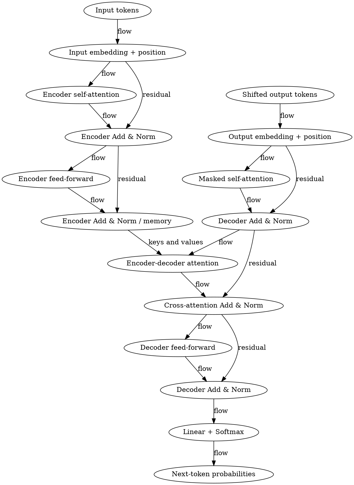
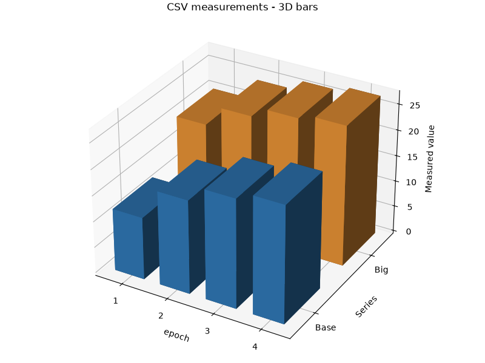

# 模块六补齐验收（2026-10-26）

开工前git pull --ff-only输出Already up to date.，工作区干净，main为`0d81daf0aac3c6fa10f5d418e1026fcf4dbb7f64`。本单只改backend/与tests/，前端、contracts/、docs/、prompts/、experiments/及test-records/零改动。旧报告保留，本文为新文件。

最终结论：三种拓扑脚本、三维柱图与受限真模型趋势图注、中→英摘要与全文已落地并通过本机验收。三维雷达图是可选项，本轮未实现；TikZ已完成格式自检，未做TeX编译，不将其写成编译通过。前端展示与同步滚动没有在本单接入。

| 项目 | 新增/扩展接口 | 实测结果 |
| --- | --- | --- |
| 拓扑 | POST /api/v1/topologies | 16节点、20边；TikZ/DOT/Mermaid自检通过；0.055782秒 |
| 三维柱图 | POST /api/v1/charts/csv/3d | 800×600 PNG、4行数据、2系列、8根柱；真模型图注；1.324083秒 |
| 中→英摘要 | POST /api/v1/papers/{paper_id}/translate，target=en | 6段对齐；3.721659秒 |
| 中→英全文 | 同上，scope=full | 175段、59607字符Markdown；56.239113秒 |

## 语料与来源

拓扑使用**官方 pdf/ 真文件1706.03762v7.pdf**已解析的Attention记录（175 Chunk），未重新跑PDF解析；文件SHA-256与PaperMeta.file_hash一致：`bdfaa68d8984f0dc02beaca527b76f207d99b666d31d1da728ee0728182df697`。没有把官方PDF提交进Git或COPY进镜像。

三维图使用自制演示CSV，**不是论文实验值**。回译直接读取第④单已产出的data/translation-acceptance/abstract-response.json及full-response.json，逐段与已提交translation-live-results.json最后成功轮的manifest比较，中文原稿与原文散列全部匹配，未手写/重造中文验收样本。两个输入文件的实际SHA-256及匹配状态见module6-completion-results.json。

## 拓扑脚本与格式自检

输入是paper_ids与logic/framework二选一。logic明确提供nodes（id、label、source_chunk_ids，可选column/row）和edges（from_id、to_id、label、source_chunk_ids）；framework接受原FrameworkOutline。生成器为确定性渲染器，不冒充模型自动推断架构。每个节点/边返回真实Chunk锚点；框架模式只连章节顺序边，明确不是因果推断。

样本按官方原文整理编码器/解码器单层内部流程、残差连接、跨注意力的K/V记忆和输出投影；原文说明堆叠N=6，图展示代表层与数据流，不声称把六层逐层展开。依据包括PDF第3页Encoder/Decoder段、第5页encoder-decoder attention与Embeddings/Softmax段，以及位置编码段；完整输入与锚点在module6-topology.json。

| 格式 | 内置自检 | 独立验证 |
| --- | --- | --- |
| TikZ | 括号/关键字/节点/边解析与输入等价通过 | pdflatex/xelatex/lualatex均未找到；未编译PDF。脚本需要ctexart与tikz环境 |
| DOT | 16节点20边，解析与输入等价通过 | @viz-js/viz 3.31.0，Graphviz WASM实际渲染SVG通过 |
| Mermaid | 16节点20边，解析与输入等价通过 | mermaid.parse 12.2.0 + jsdom 30.1.3，实际解析为flowchart-v2 |

内置解析器只支持本生成器输出的严格语法子集，不声称是通用TeX编译器。格式不合法、括号/关键字缺失、未知节点、额外语句或图不等价都会失败，不返回不合法脚本。标签按语言转义。独立解析脚本对源文件采用CRLF→LF规范化散列，避免Windows换行造成假不一致。初次散列审计受换行影响，规范化后重新运行两个独立解析器与审计均通过。

[Graphviz真实渲染SVG](module6-topology-dot.svg)；原始脚本文件分别为module6-topology.tex、module6-topology.dot、module6-topology.mmd。下列为本轮API实际返回的完整脚本：

### tikz

```latex
\documentclass{ctexart}
\usepackage{tikz}
\begin{document}
\begin{tikzpicture}[every node/.style={draw,rounded corners,align=center,text width=42mm}]
\node (n0) at (0,0) {Input tokens};
\node (n1) at (0,-2) {Input embedding + position};
\node (n2) at (0,-4) {Encoder self-attention};
\node (n3) at (0,-6) {Encoder Add \& Norm};
\node (n4) at (0,-8) {Encoder feed-forward};
\node (n5) at (0,-10) {Encoder Add \& Norm / memory};
\node (n6) at (6,0) {Shifted output tokens};
\node (n7) at (6,-2) {Output embedding + position};
\node (n8) at (6,-4) {Masked self-attention};
\node (n9) at (6,-6) {Decoder Add \& Norm};
\node (n10) at (6,-8) {Encoder-decoder attention};
\node (n11) at (6,-10) {Cross-attention Add \& Norm};
\node (n12) at (6,-12) {Decoder feed-forward};
\node (n13) at (6,-14) {Decoder Add \& Norm};
\node (n14) at (6,-16) {Linear + Softmax};
\node (n15) at (6,-18) {Next-token probabilities};
\draw[->] (n0) -- node[above,draw=none] {flow} (n1);
\draw[->] (n1) -- node[above,draw=none] {flow} (n2);
\draw[->] (n2) -- node[above,draw=none] {flow} (n3);
\draw[->] (n3) -- node[above,draw=none] {flow} (n4);
\draw[->] (n4) -- node[above,draw=none] {flow} (n5);
\draw[->] (n6) -- node[above,draw=none] {flow} (n7);
\draw[->] (n7) -- node[above,draw=none] {flow} (n8);
\draw[->] (n8) -- node[above,draw=none] {flow} (n9);
\draw[->] (n9) -- node[above,draw=none] {flow} (n10);
\draw[->] (n10) -- node[above,draw=none] {flow} (n11);
\draw[->] (n11) -- node[above,draw=none] {flow} (n12);
\draw[->] (n12) -- node[above,draw=none] {flow} (n13);
\draw[->] (n13) -- node[above,draw=none] {flow} (n14);
\draw[->] (n14) -- node[above,draw=none] {flow} (n15);
\draw[->] (n5) -- node[above,draw=none] {keys and values} (n10);
\draw[->] (n1) -- node[above,draw=none] {residual} (n3);
\draw[->] (n3) -- node[above,draw=none] {residual} (n5);
\draw[->] (n7) -- node[above,draw=none] {residual} (n9);
\draw[->] (n9) -- node[above,draw=none] {residual} (n11);
\draw[->] (n11) -- node[above,draw=none] {residual} (n13);
\end{tikzpicture}
\end{document}
```

### dot



### mermaid

```text
flowchart TD
  n0["Input tokens"]
  n1["Input embedding + position"]
  n2["Encoder self-attention"]
  n3["Encoder Add #38; Norm"]
  n4["Encoder feed-forward"]
  n5["Encoder Add #38; Norm / memory"]
  n6["Shifted output tokens"]
  n7["Output embedding + position"]
  n8["Masked self-attention"]
  n9["Decoder Add #38; Norm"]
  n10["Encoder-decoder attention"]
  n11["Cross-attention Add #38; Norm"]
  n12["Decoder feed-forward"]
  n13["Decoder Add #38; Norm"]
  n14["Linear + Softmax"]
  n15["Next-token probabilities"]
  n0 -->|"flow"| n1
  n1 -->|"flow"| n2
  n2 -->|"flow"| n3
  n3 -->|"flow"| n4
  n4 -->|"flow"| n5
  n6 -->|"flow"| n7
  n7 -->|"flow"| n8
  n8 -->|"flow"| n9
  n9 -->|"flow"| n10
  n10 -->|"flow"| n11
  n11 -->|"flow"| n12
  n12 -->|"flow"| n13
  n13 -->|"flow"| n14
  n14 -->|"flow"| n15
  n5 -->|"keys and values"| n10
  n1 -->|"residual"| n3
  n3 -->|"residual"| n5
  n7 -->|"residual"| n9
  n9 -->|"residual"| n11
  n11 -->|"residual"| n13
```

## 三维图与趋势图注

新接口接收multipart file、value_columns（JSON数组）、可选x_column。至少两行、最多8个系列/1000根柱；数值横轴严格递增，未指定时按CSV逻辑行序，不假称时间。Matplotlib版本`3.11.2`，实际使用bar3d；不是把二维图片换个名字。

响应为{chart,projection,data_table,conclusions,series_aliases,metadata}；chart仍严格通过原ChartOutput v1.1，chart_type=bar，外层projection=3d。原二维/charts/csv与其七字段响应、无Key行为、受限数值图注均保持；没有扩展ChartOutput枚举或写入QAAnswer。

自制输入CSV：

```csv
epoch,Base,Big
1,12,20
2,18,24
3,21,26
4,22.5,27
```

| CSV逻辑行（表头=1） | epoch | Base | Big |
| ---: | ---: | ---: | ---: |
| 2 | 1 | 12 | 20 |
| 3 | 2 | 18 | 24 |
| 4 | 3 | 21 | 26 |
| 5 | 4 | 22.5 | 27 |

PNG：800×600，63146字节，SHA-256=`048ac365fb98041d6b2679e69f6b79021e1a33b144aaa177b9cead311f56af8c`。已目视核对八根柱、横轴/系列/高度与数据表，未见裁切或空白占位。



API实际图注：

> Base在所给数据中呈单调上升趋势，且变化速率的绝对值逐步减小，变化正在放缓。
> Big在所给数据中呈单调上升趋势，且变化速率的绝对值逐步减小，变化正在放缓。

两条结论各回溯CSV逻辑行2、3、4、5，csv_anchors包含CSV散列、行号和系列列名；data_table给出完整所选数据。Base相邻增量6、3、1.5，Big增量4、2、1，横轴步长均为1，故上升且速率减小可由源行复核。chart.numeric_checks含横轴与两个系列的全部12个源单元格；定性图注没有额外数字事实。

方法如实标为deepseek_grounded_selection：代码先用Fraction算出可核验的趋势/变化率事实，真模型读取数据与事实，在验证过的解释性候选中选择完整中文解读，代码再核对趋势、形态、每条数据行和文本。返回的图注确实取自模型响应；不是只枚举数字，也不声称自由生成了因果解释或未来预测。当前候选空间受限，这是防止无依据结论的边界。

缺Key/模型名或上游失败返回502/UPSTREAM_ERROR，绝不使用无Key假图注。CSV非法为422/CSV_INVALID，错误趋势/行号/非核验文本等为422/CHART_VALIDATION_FAILED。失败最多重试一次，仍错不发布部分成功图表。数值列名包含数字时以系列甲等别名写图注，并返回series_aliases，避免把标识符数字误当测量事实。

## 中→英输入与对齐链

同一翻译端点新增target=en，仅支持abstract/full。原生中文落盘Chunk可直接请求；英文论文的回译用新增可选字段source_translation提交此前target=zh响应。后端验证同篇论文、原英文source_text、Chunk标识唯一性、物理页/章节/类型、覆盖范围和保护片段；不会直接复用英文PDF原文冒充回译。

本次模型只收到上一轮真实中文正文与术语上下文，未把原英文全文作为回译答案输入。source_text在回译响应中是本次实际中文源段，source_chunk_id仍回指原论文Chunk，构成“原论文→中文→英文”的对齐链；不是声称中文段落就是英文PDF字面引用。metadata.source_translation_sha256锁定中文输入，source_input区分原生中文与客户端前次译文。

原译稿的模型来源不是任意客户端响应的签名认证；验收通过旧任务已提交manifest与本地派生文件比对来证明本次来源真实。新增source_translation请求字段、target=en传输枚举与metadata来源说明均为向后兼容加法，已有响应字段保留，冻结业务schema/example零改动。

摘要样本源Chunk：`paper-bdfaa68d8984f0dc02beaca527b76f207d99b666d31d1da728ee0728182df697-p0001-c00010`，PDF第1页；回译摘要共6段，全文175段及59607字符Markdown，均有一一对齐定位点。代码块、行内代码、LaTeX与结构由代码原位保留，另用自制样例覆盖，不假称官方解析已有独立formula记录。

### 第④单真实中文摘要（本次输入）

> 主流的序列转导模型基于复杂的循环或卷积神经网络，其中包含一个编码器和一个解码器。性能最好的模型还通过注意力机制将编码器和解码器连接起来。我们提出了一种新的简单网络架构——Transformer，它完全基于注意力机制，完全摒弃了循环和卷积。在两个机器翻译任务上的实验表明，这些模型在质量上更优，同时具有更强的并行性，且训练所需时间显著更少。我们的模型在 WMT 2014 英德翻译任务上达到 28.4 BLEU，比现有最佳结果（包括集成模型）高出 2 BLEU 以上。在 WMT 2014 英法翻译任务上，我们的模型在八块 GPU 上训练 3.5 天后，建立了新的单模型最先进水平 BLEU 分数 41.8，这只是文献中最佳模型训练成本的一小部分。我们通过将 Transformer 成功应用于英语成分句法分析（无论训练数据充足还是有限），表明它能很好地泛化到其他任务。

### 本次真模型英文回译（实际输出）

> The dominant sequence transduction models are based on complex recurrent or convolutional neural networks that include an encoder and a decoder. The best performing models also connect the encoder and decoder through an attention mechanism. We propose a new simple network architecture, the Transformer, based solely on attention mechanisms, dispensing with recurrence and convolutions entirely. Experiments on two machine translation tasks show these models to be superior in quality while being more parallelizable and requiring significantly less time to train. Our model achieves 28.4 BLEU on the WMT 2014 English-to-German translation task, improving over the existing best results, including ensembles, by over 2 BLEU. On the WMT 2014 English-to-French translation task, our model establishes a new single-model state-of-the-art BLEU score of 41.8 after training for 3.5 days on eight GPUs, a small fraction of the training costs of the best models from the literature. We show that the Transformer generalizes well to other tasks by applying it successfully to English constituency parsing both with large and limited training data.

逐句对照核对（Codex完成，非用户或领域专家签审）：本段含义保留。编码器/解码器、纯注意力且无循环/卷积、质量/并行与训练成本比较、28.4 BLEU、提高超过2 BLEU、41.8 BLEU、3.5天和八块GPU等信息保留，未在样本发现新增事实。这里确认的是摘要抽查；全文结构与数字通过代码校验，不把它写成175段已逐句人工审校。

## 真实调用与失败记录

DEEPSEEK_API_KEY、DEEPSEEK_MODEL均已设置；Key只由进程环境传给现有DeepSeekClient，不写入代码、文件、日志或报告。服务商deepseek，请求模型名deepseek-chat；不猜测别名背后的模型版本。以下用量仅为最后一轮成功请求，不是整个开发会话累计。拓扑不调用模型。

| 请求 | 耗时（秒） | 调用数 | token总数 |
| --- | ---: | ---: | ---: |
| chart_3d | 1.324083 | 1 | 756 |
| back_translation_abstract | 3.721659 | 1 | 2098 |
| back_translation_full | 56.239113 | 7 | 41493 |

安全调用元数据逐项保留provider/model/phase/elapsed_seconds/prompt_tokens/completion_tokens/total_tokens/http_status/status；不保存请求协议正文、思考内容或Key。有限原译样本按任务要求入报告；完整回译和图表JSON只留忽略的data/module6-completion/。

| 开发轮次 | 实际结论 |
| --- | --- |
| 1 | topology: passed / chart_3d: passed / back_translation_abstract: passed / back_translation_full: failed；术语未按本次词表统一：注意力 |
| 2 | topology: passed / chart_3d: passed / back_translation_abstract: passed / back_translation_full: failed；术语未按本次词表统一：困惑度 |
| 3 | topology: passed / chart_3d: passed / back_translation_abstract: passed / back_translation_full: passed |

前两轮全文回译实际返回502，分别因attention/attend的动词用法、perplexity/perplexities的复数被代码术语检查误拒。已支持可解释的英文语法词形，且补上真正漏译仍失败的测试；保留初始失败，不把失败算通过。最终轮四项全部通过。

## 全量回归与审计

全量JUnit：**448通过，0失败、0错误、0跳过**，JUnit计时181.173000秒（含真实OCR、既有模型/SSE与新增模型测试）。

无Key/模型变量子进程：64项，**62通过、2项实连跳过**，0失败/错误，9.321000秒。拓扑为确定性生成，不需要Key，照常验证；仅新增真实图注/中→英实连测试跳过，不伪造成实连通过。

新增测试覆盖三种脚本语法/括号/关键字/图等价/标签转义/锚点；三维PNG与表格、单调/波动与速率、错误结论/行号/图像篡改、CSV与配置错误；中文源对齐、伪造来源字段、原生中文、代码/公式、日期计数与单位、英语词形和漏译。普通测试用自制契约样例/CSV，非官方PDF质量评测；真实样本来源单独如上登记。

独立审计38项全部通过：官方源文件散列、最终实现散列、拓扑输入/脚本/外部解析/实际SVG、图注/CSV/PNG、旧译文manifest链、全量回归与无Key跳过、目录范围、旧报告保留、pdf/忽略、真实Key字节不在本单文件中。

复现（本地已有依赖、官方PDF及第④单已解析/中文稿数据，实连需启动环境的Key与模型名）：

```powershell
backend/.venv/Scripts/python.exe tests/run_module6_completion_acceptance.py
backend/.venv/Scripts/python.exe -m pytest tests -q --run-ocr --run-real-model --basetemp data/module6-reproduce-tests --junitxml tests/reports/module6-completion-pytest.xml
backend/.venv/Scripts/python.exe tests/audit_module6_completion.py
backend/.venv/Scripts/python.exe tests/render_module6_completion_report.py
```

独立DOT/Mermaid依赖仅安装在忽略目录：npm --cache data/module6-tools/npm-cache install --ignore-scripts --no-audit --no-fund --prefix data/module6-tools @viz-js/viz@3.31.0 mermaid@12.2.0 jsdom@30.1.3；然后node tests/validate_topology_scripts.mjs。本轮安装/解析均由移除Key等敏感变量的子进程执行；使用D盘缓存规避全局npm缓存EEXIST，未改全局npm配置。它们不是生产后端运行依赖。

交付证据包括module6-completion-results.json、module6-topology.json及三种脚本、独立解析JSON与SVG、CSV与PNG、两份JUnit、module6-completion-audit.json和探针/审计/报告生成脚本。既有报告与契约未改，pdf/继续忽略，语料不进Git或镜像。

## 转达WorkBuddy

拓扑读取scripts[*].format/script与validation；三维图显示chart.image_ref，并展示data_table、conclusions的row_numbers/csv_anchors，注意外层projection=3d；回译使用此前中文响应作为source_translation，依同一source_chunk_id衔接中英段落。前端本单未接入；旧Docker镜像未重建，不声称新接口已部署进旧容器。

实现依据：[DOT语法](https://graphviz.org/doc/info/lang.html)、[Mermaid流程图](https://mermaid.js.org/syntax/flowchart.html)、[TikZ节点与边](https://tikz.dev/tikz-shapes)、[Matplotlib三维柱图](https://matplotlib.org/stable/gallery/mplot3d/3d_bars.html)。
